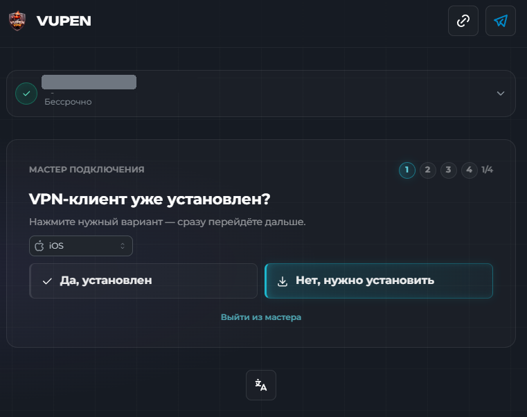
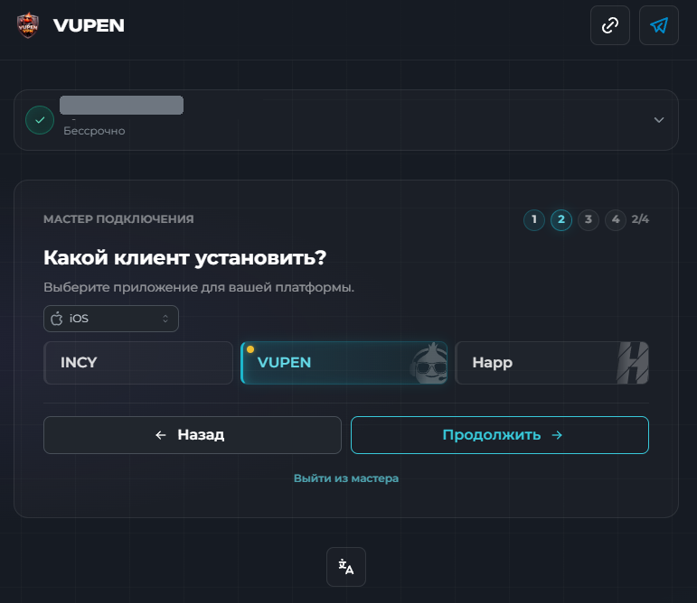

# Remnawave Subscription Page — Connection Wizard

Публичный форк [remnawave/subscription-page](https://github.com/remnawave/subscription-page) (AGPL-3.0).

Цель форка — сделать подключение к VPN проще: вместо длинного гайда пользователь проходит короткий **мастер подключения** из 4 шагов.

**Мастер включён по умолчанию.** Классический интерфейс доступен по кнопке «Выйти из мастера».

---

## Задумка

Классическая страница показывает сразу весь гайд: несколько клиентов, блоки установки, «добавить подписку», ключи. На телефоне важные кнопки часто оказываются ниже экрана — люди теряются.

Мастер ведёт пользователя по одному вопросу за раз:

1. **Клиент уже установлен?** — быстрый выбор «Да» / «Нет»
2. **Какой клиент?** — список приложений для определённой ОС
3. **Установка** — только если клиента ещё нет (иначе шаг пропускается)
4. **Добавить подписку** — одна понятная кнопка с названием клиента

### Принципы UX

- Фокус на вопросе шага, а не на декоративных заголовках
- Единый визуальный язык со стандартной страницей (тёмная тема, cyan-акценты)
- На шаге 1 нет «Назад / Продолжить» — выбор сразу ведёт дальше
- На шагах 2–4 одинаковые кнопки навигации
- Компактная вёрстка на мобильных
- «Выйти из мастера» открывает классический интерфейс

---

## Скриншоты

### Шаг 1 — есть ли клиент

Пользователь отвечает на один вопрос. Платформа определяется автоматически (можно сменить).



### Шаг 2 — выбор клиента

Список приложений для выбранной ОС. Дальше — установка или сразу подписка.



### Шаги 3–4 (кратко)

| Шаг | Если клиента нет | Если клиент уже есть |
| --- | --- | --- |
| 3 | Кнопки установки с названием клиента в скобках | *пропускается* |
| 4 | Кнопка «Добавить подписку в {клиент}» | Кнопка «Добавить подписку в {клиент}» |

---

## Как это работает

| Действие | Что видит пользователь |
| --- | --- |
| Открыл ссылку подписки | мастер подключения (по умолчанию) |
| «Выйти из мастера» | классическая страница в этой сессии |

---

## Что изменено относительно upstream

- виджет `connection-wizard` — пошаговый мастер **по умолчанию**
- классический гайд остаётся доступен через «Выйти из мастера»
- более компактная мобильная вёрстка всей страницы подписки

Лицензия та же: **AGPL-3.0**. Upstream: [remnawave/subscription-page](https://github.com/remnawave/subscription-page).

Документация Remnawave: [docs.rw](https://docs.rw/).

---

## Установка и обновление на VPS

Подходит, если у вас уже крутится Remnawave Subscription Page (обычно `/opt/remnawave/subscription`) и вы хотите заменить официальный образ на этот форк с мастером.

Нужны: Docker + Docker Compose, Node.js 24 (только для сборки фронта), git.

### 1. Забрать форк

```bash
sudo mkdir -p /opt/remnawave/subscription-src
sudo chown "$USER":"$USER" /opt/remnawave/subscription-src
cd /opt/remnawave/subscription-src

git clone https://github.com/BobJustFry/remnawave-subscription.git .
```

Если репозиторий уже клонирован:

```bash
cd /opt/remnawave/subscription-src
git pull
```

### 2. Собрать frontend

Docker-образ ожидает уже собранный `frontend/dist`:

```bash
cd /opt/remnawave/subscription-src/frontend
npm ci
npm run start:build
```

### 3. Собрать Docker-образ

```bash
cd /opt/remnawave/subscription-src
sudo docker build -t remnawave-subscription:local .
```

### 4. Переключить compose на свой образ

Откройте compose подписки (часто так):

```bash
sudo nano /opt/remnawave/subscription/docker-compose.yml
```

Замените `image` на локальный:

```yaml
services:
  remnawave-subscription-page:
    image: remnawave-subscription:local
    container_name: remnawave-subscription-page
    hostname: remnawave-subscription-page
    restart: always
    env_file:
      - .env
    ports:
      - '127.0.0.1:3010:3010'
    networks:
      - remnawave-network

networks:
  remnawave-network:
    name: remnawave-network
    driver: bridge
    external: true
```

Файл `.env` не трогайте, если панель уже настроена (`REMNAWAVE_PANEL_URL`, `REMNAWAVE_API_TOKEN`, `CUSTOM_SUB_PREFIX` и т.д.).

Пример переменных — в [`.env.sample`](.env.sample).

### 5. Запустить / пересоздать контейнер

```bash
cd /opt/remnawave/subscription
sudo docker compose up -d --force-recreate
sudo docker ps --filter name=remnawave-subscription-page
```

Статус должен быть `healthy`. Дальше откройте обычную ссылку подписки — мастер покажется сразу.

### Обновление форка на VPS

Когда в GitHub появятся новые коммиты:

```bash
cd /opt/remnawave/subscription-src
git pull

cd frontend
npm ci
npm run start:build

cd ..
sudo docker build -t remnawave-subscription:local .

cd /opt/remnawave/subscription
sudo docker compose up -d --force-recreate
```

### Откат на официальный образ

В `docker-compose.yml` верните:

```yaml
image: remnawave/subscription-page:latest
```

И пересоздайте контейнер:

```bash
cd /opt/remnawave/subscription
sudo docker compose pull
sudo docker compose up -d --force-recreate
```

### Важно (AGPL-3.0)

Если вы меняете код и отдаёте сервис пользователям по сети, исходники вашей версии тоже должны быть доступны (этот публичный форк это закрывает, пока вы не делаете закрытую модификацию без публикации).

---

## Contributors (upstream)

Thanks to all contributors who have helped improve Remnawave:

<p align="center">
  <a href="https://github.com/remnawave/subscription-page/graphs/contributors">
    
  </a>
</p>
